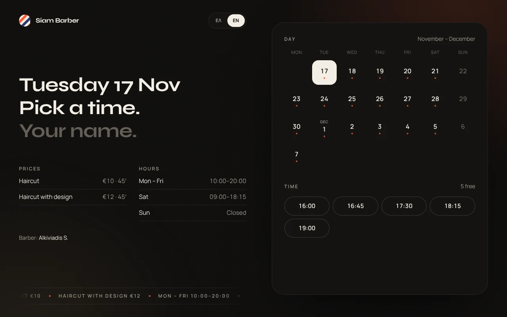
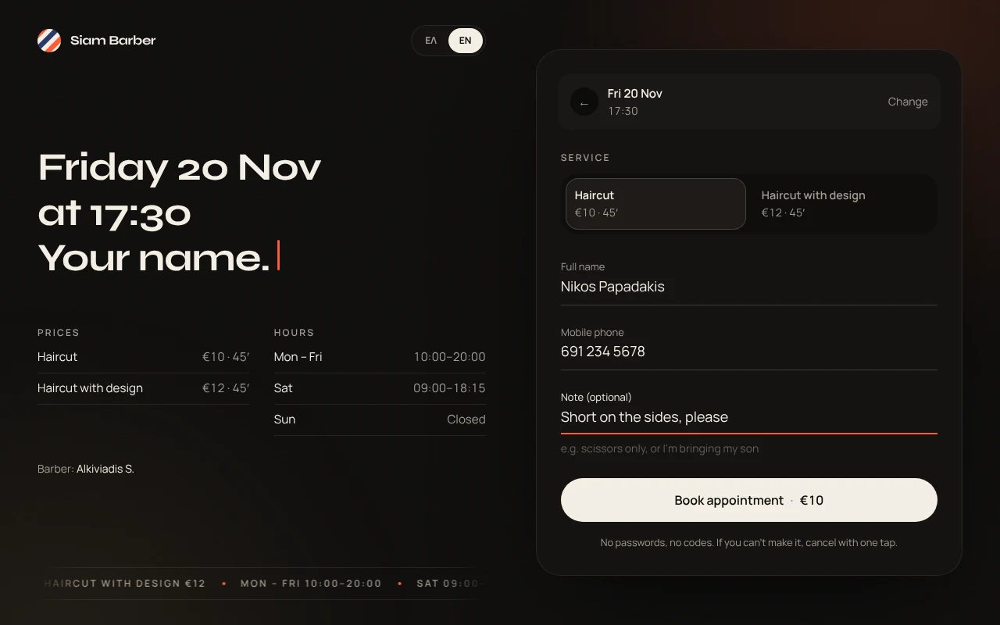
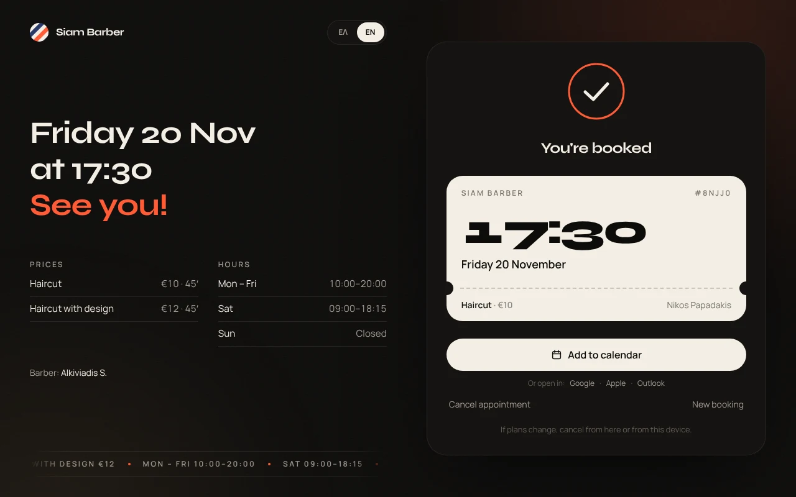
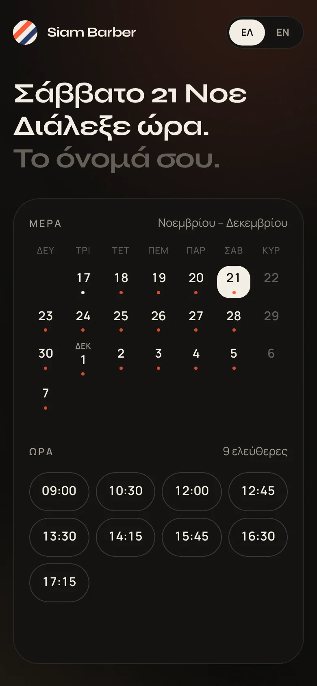
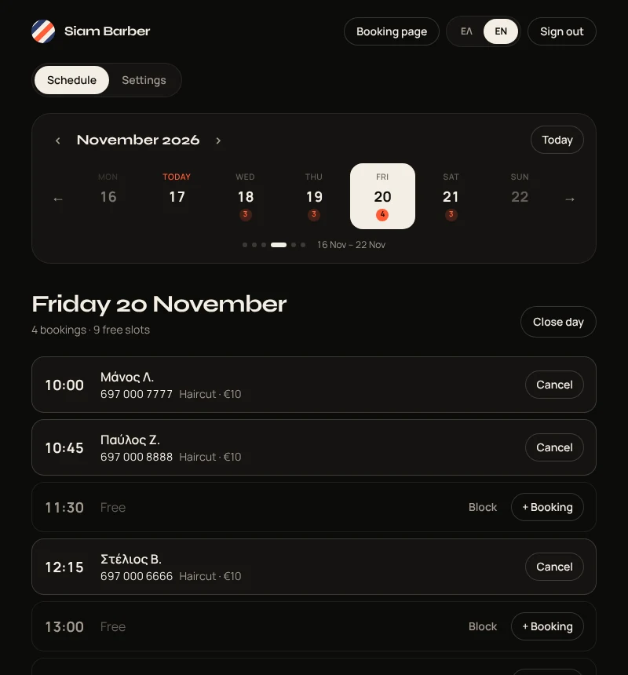
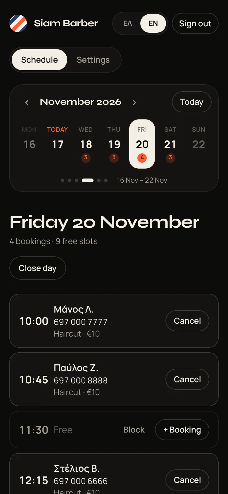

# Siam Barber · Online booking

[](https://github.com/40is40inos/siam-barber/actions/workflows/ci.yml)

A booking site built for **Siam Barber**, a one-chair barber shop in Greece, to replace its ebarber.gr booking page. Customers pick a day and a time, type their name and phone, and they're booked: no accounts, no codes. The barber runs his schedule, prices and opening hours from his phone.

**Live: https://siam-barber.40is40inos.workers.dev**. The shop hasn't started using it yet, so feel free to book a test appointment, then cancel it with the link on the confirmation screen.



## Screenshots

| Pick a time, enter your details | Booked, with a calendar invite |
|---|---|
|  |  |

| Customer, on a phone (Greek) | The barber's schedule | The barber's schedule, on a phone |
|---|---|---|
|  |  |  |

The screenshots come from a local copy with made-up bookings.

## Features

**Customers**
- Book in three steps: day, time, name and phone, with an optional note. The big headline doubles as the progress indicator.
- Greek by default, with a one-tap English switch.
- Add the appointment to Google, Apple or Outlook calendars.
- Cancel with a private link. The device also remembers the booking and shows it on the next visit.

**The barber (`/admin`)**
- A month view browsed week by week, with booking counts.
- Each slot is booked (name, tap-to-call phone, service, cancel), free (**+ Booking** for phone or walk-in customers, or **Block**), or blocked.
- Close a whole day, or a range of days with a note ("Christmas") that customers see.
- Settings he edits himself: services and prices, opening hours with up to three ranges a day for breaks, appointment length, how far ahead customers can book, and bookings per phone.
- The screen refreshes every 30 seconds and when the tab regains focus.

## Engineering notes

- **No double bookings.** The overlap check and the insert run in one database write transaction. A partial unique index on `(date, time) WHERE status = 'active'` backs it up. Overlaps use each booking's stored length, so changing the appointment length later never double-books. On the live deployment, five simultaneous requests for the same slot gave exactly one booking; the other four were told the slot was taken.
- **Abuse limits without accounts.**
  - The server re-checks every booking: on the schedule, inside the booking window, not in the past, day not closed.
  - Phone numbers are normalised to one format (`691 234 5678`, `+30…` and `0030…` are the same number) and capped at a set number of upcoming bookings (2 by default).
  - A hidden honeypot field stops simple form bots.
- **The cancel link uses the URL fragment** (`/cancel#<token>`), so the token is never sent to the server and never appears in server logs.
- **Admin login with no secrets in config.**
  - On a fresh database, the first visit to `/admin` asks the barber to create his password.
  - It is stored as a salted PBKDF2-SHA256 hash using the Web Crypto API. The iteration count fits Cloudflare Workers' CPU budget per request and is stored with each hash, so it can be raised later.
  - The session cookie is HMAC-signed with a key that includes the password hash, so changing the password signs out every other device.
  - Five wrong attempts lock an IP out for 10 minutes. The lock is stored in the database, so it holds across Workers instances.
- **Built for Cloudflare Workers.**
  - Next.js runs on Workers through OpenNext. A new database client is created per request, because Workers forbid sharing connections between requests.
  - Next 16's Cache Components feature is turned off because OpenNext doesn't support it yet.
- **The schema upgrades itself.** New columns are added through a list of `ALTER TABLE` migrations that run at startup.
- **Small but polished.**
  - Every text exists in Greek and English, and errors are stored as codes, so switching language translates messages already on screen.
  - Animations respect the system's reduced-motion setting.
  - Both fonts include Greek characters.

## Stack

Next.js 16 (App Router), React 19, TypeScript, Tailwind CSS 4, Motion, shadcn/ui calendar, libSQL/SQLite (Turso). Deployed on Cloudflare Workers via OpenNext.

## Run it locally

```bash
npm install
npm run dev
```

Open http://localhost:3000 and http://localhost:3000/admin. The local database is created automatically in `data/siam-barber.db`. No settings file is needed; `.env.example` lists the optional ones.

Checks, also run by CI on every push:

```bash
npx eslint src
npx next typegen && npx tsc --noEmit
npm run build
```

## Deploy

**Cloudflare Workers + Turso (free tiers), the current setup**
1. Connect the GitHub repo to a Worker named `siam-barber` (Workers Builds). Build command: `npx opennextjs-cloudflare build`. Deploy command: `npx opennextjs-cloudflare deploy`.
2. Create a free Turso database and a token at [turso.tech](https://turso.tech).
3. In the Worker's **Settings → Variables and Secrets**, add `DATABASE_URL` (`libsql://…`) and `DATABASE_AUTH_TOKEN`, both as type **Secret**.
4. Deploy, then open `/admin` straight away and create the admin password. Until then, whoever opens `/admin` first can set it.

**A VPS or any Node host with a disk**

```bash
npm ci && npm run build
DATABASE_URL=file:/var/lib/siam-barber/siam.db npm start
```

The tables are created on the first request.

## Project structure

```text
src/
├── app/
│   ├── page.tsx              # customer booking page
│   ├── cancel/               # cancellation page (/cancel#<token>)
│   ├── admin/                # the barber's screen
│   └── api/                  # thin route handlers: validate, call lib/, return JSON
├── components/
│   ├── booking/              # booking flow: day grid, times, details, confirmation
│   └── admin/                # schedule, week pager, quick booking, settings
└── lib/
    ├── bookings.ts           # availability, create/cancel, day view, blocks, holidays
    ├── time.ts               # date and slot math in the shop's time zone
    ├── auth.ts               # admin password, sessions, lockout
    ├── db.ts                 # libSQL client, schema, migrations
    ├── settings*.ts          # shop settings, defaults, validation
    └── i18n.ts               # Greek and English texts
```

`src/lib/config.ts` holds the shop's fixed details (name, barber, area, time zone) and the starting values for the settings, used until the barber first saves his own.
